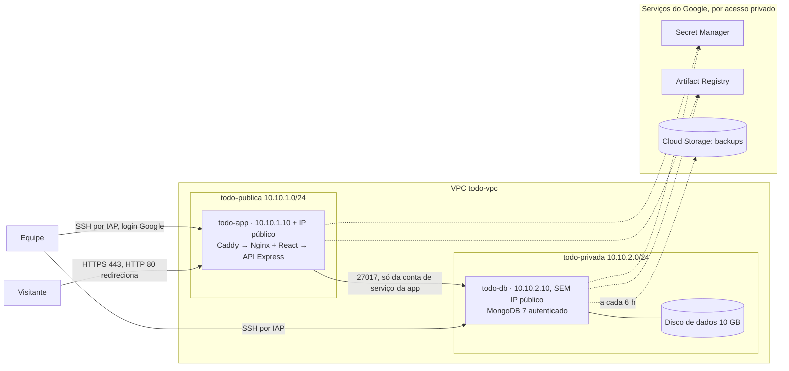

# Arquitetura · ToDo App na Google Cloud

Arquitetura da implantação para a Feira de Profissões, conforme o [escopo](escopo.md).
A versão local em LocalStack, mantida como plano B, está em [localstack/arquitetura.md](localstack/arquitetura.md).

## 1. Decisões

| Decisão | Escolha | Por quê |
| --- | --- | --- |
| Provedor | Google Cloud, projeto exclusivo | Azure for Students e Oracle Cloud não liberaram conta; a AWS grátis só vale para conta nova. A GCP tem cota permanente para VMs pequenas. |
| Região | `us-east1` | A cota grátis só existe em três regiões dos EUA. Latência maior que São Paulo, aceitável para uma lista de tarefas. |
| VMs | 2 × `e2-micro` (1 GB), Ubuntu 24.04 | Menor máquina que atende; medido em uso (seção 6). |
| Acesso administrativo | SSH por Identity-Aware Proxy | Porta 22 fechada na internet, sem depender do IP de quem administra. |
| Ferramentas | Terraform 1.9.8 em contêiner, Bash, Docker Compose, GitHub Actions | Os mesmos arquivos das VMs servem à GCP e ao LocalStack. |

## 2. Visão geral

O Nginx entrega a interface e encaminha `/todos`, `/todos/:id` e `/health` à API no mesmo endereço. Só a API acessa o MongoDB. O fluxo funcional é o da seção 6 do escopo.

## 3. Segurança (REQ-02, REQ-03)

- **Entradas permitidas, só três:** 80/443 públicas na VM da aplicação; 27017 no banco, vinda da conta de serviço da aplicação; 22 nas duas VMs, vinda somente da faixa do IAP (35.235.240.0/20). O resto é recusado pela VPC.
- **Banco:** sem IP público, MongoDB escutando só em 10.10.2.10, e uma regra `iptables` na própria VM repete a restrição.
- **Privilégio mínimo:** uma conta de serviço por VM. A aplicação lê só a própria senha. O banco lê as duas, e no bucket cria e lê backups, sem sobrescrever nem apagar.
- **Segredos:** gerados na máquina de quem administra (`.local/`, fora do Git), enviados ao Secret Manager por stdin e gravados nas VMs em arquivos 0400. Não entram no código, no estado do Terraform, na linha de comando nem nos logs; o aceite procura os valores reais.
- **HTTPS:** Caddy com certificado Let's Encrypt, renovação automática, redirecionamento 308 e HSTS. O endereço é `<ip>.sslip.io`, um DNS público gratuito que aponta para o próprio IP.
- **GitHub Actions sem chave de nuvem:** identidade por OIDC ([infra/gcp-ci](../infra/gcp-ci/main.tf)), limitada a um repositório, ao branch `main` e a execução manual. Não cria nem apaga recursos. A chave SSH fica em um *secret* do repositório.

## 4. Persistência, backup e restauração (REQ-04)

| Item | Como |
| --- | --- |
| Dados | Disco separado em `/mnt/mongo-data`. Se ele não montar, o Docker não sobe, para o banco não iniciar vazio no disco errado. Só é formatado um disco sem sistema de arquivos. |
| Backup | A cada 6 h, e antes de deploy do banco, limpeza, restauração, pausa e desativação. Retenção de 30 dias no bucket, com as 5 cópias mais recentes no disco. `backup` também copia para `.local/backups/`. |
| Restauração de teste | MongoDB temporário, sem rede. A produção não é tocada. |
| Restauração real | Pede `RESTAURAR` e faz um backup antes. |

## 5. Automação e infraestrutura como código

| Operação do escopo | Rotina (`./scripts/pipeline-gcp.sh …`) |
| --- | --- |
| Validar e planejar | `validar` · `planejar` |
| Provisionar e configurar | `bootstrap` (uma vez) · `provisionar` (aplica o plano exibido) · `preparar` |
| Implantar e atualizar | `implantar` (versão = commit) · `implantar <versão>` (rollback) · `versoes` |
| Manter e diagnosticar | `status` · `logs-app` · `logs-banco` · `reiniciar-app` · `reiniciar-banco` |
| Proteger e recuperar | `backup` · `backups` · `restaurar-teste` · `restaurar` |
| Desativar | `pausar` · `retomar` · `nat` · `desativar` |

- **Estado do Terraform:** bucket privado e versionado. Para recuperar, restaure a versão anterior do objeto `todo-app/default.tfstate`.
- **Versões:** imagens com o SHA do commit no Artifact Registry. A imagem do banco só muda quando `banco-de-dados/` muda, então atualizar a aplicação não reinicia o MongoDB.
- **Workflows:** `ci.yml` (validação e integração), `localstack.yml` (ciclo completo local) e `gcp.yml` (plano, implantação, rollback e aceite na GCP).

## 6. Dimensionamento medido (24/11/2026)

| VM | Memória usada | Swap | Disco de sistema |
| --- | --- | --- | --- |
| `todo-app` | 501 de 953 MB | 18 MB | 52% |
| `todo-db` | 365 de 953 MB | 143 MB | 60% |

Medido em repouso, após o aceite. A margem é pequena: um healthcheck pesado chegou a travar a VM do banco durante um teste (causa e correção no [relatório](relatorio-validacao.md)). O MongoDB usa cache fixo de 0,25 GB e cada VM tem 1 GB de swap. **Não foi feito teste de carga.** Se a feira exigir mais, mude `app_machine_type` ou `db_machine_type` para `e2-small`.

## 7. Limitações e premissas

| Item | Impacto e tratamento |
| --- | --- |
| Data, público e domínio não informados no escopo | Premissa: apresentação na semana de 30/11/2026, algumas dezenas de visitantes. Confirmar com a organização. |
| Uma VM por função | Se uma cair, o site para. Reinício automático dos serviços e backup; sem alta disponibilidade, o que o escopo não pede. |
| `sslip.io` é de terceiros | Se sair do ar, o endereço não resolve. Alternativa: domínio próprio em `site_address`. |
| Lista compartilhada | Como no escopo; use `limpar-lista` antes de cada apresentação. |
| NAT desligado | O banco não baixa pacotes da internet. Para atualizar: `nat ligar`, atualizar, `nat desligar`. |
| Recriar tudo muda o IP | `desativar` libera o IP. Não faça isso depois de divulgar o endereço. |

## 8. Custos (ACE-09)

**Fonte:** catálogo oficial de preços da Google (Cloud Billing Catalog API), consultado em **24/11/2026**, em **USD**, região `us-east1`, sob demanda, sem impostos. Cota grátis: [documentação do Free Tier](https://docs.cloud.google.com/free/docs/free-cloud-features).

**Premissas:** mês de 730 h; período da feira de 8 dias (192 h); discos `pd-standard`.

### Preço cheio (sem cota grátis)

| Recurso | Preço | Mês | Período |
| --- | --- | --- | --- |
| 2 VMs `e2-micro` (0,25 vCPU + 1 GB) | US$ 0,00838/h cada¹ | 12,23 | 3,22 |
| Discos, 30 GB | US$ 0,04/GB-mês | 1,20 | 0,32 |
| IP público em uso | US$ 0,005/h | 3,65 | 0,96 |
| 2 segredos | US$ 0,06/mês cada | 0,12 | 0,03 |
| Imagens, até 0,5 GB | US$ 0,10/GB-mês | 0,05 | 0,01 |
| Backups, menos de 0,1 GB | US$ 0,02/GB-mês | < 0,01 | < 0,01 |
| **Total** | | **≈ 17,25** | **≈ 4,54** |

¹ 0,25 × US$ 0,02181159 (núcleo E2) + 1 × US$ 0,00292353 (GB de memória).

### Com a cota grátis, que não expira

| Recurso | Cota por mês | Mês inteiro | Período |
| --- | --- | --- | --- |
| VMs | horas de `e2-micro` iguais às do mês | 6,12 (as 730 h excedentes) | **0** (384 h) |
| Discos | 30 GB | 0 | 0 |
| IP público em uso | 721 h | ≈ 0 | 0 |
| Segredos, imagens, backups | 6 versões · 0,5 GB · 5 GB | 0 | 0 |
| **Total** | | **≈ US$ 6,12** | **≈ US$ 0** |

**O que pode variar:**

- **IP com a VM desligada custa US$ 0,01/h** (≈ US$ 0,24/dia). Pausar sai mais caro do que manter ligado dentro da cota.
- **NAT ligado:** US$ 0,0014/h por VM + US$ 0,005/h do IP + US$ 0,045/GB. Fica desligado.
- **Tráfego de saída:** 1 GB/mês grátis. O preço do excedente não foi levantado; a página é leve.
- A cota é da conta de faturamento: outro projeto com `e2-micro`, disco ou IP a divide.
- O valor final é cobrado em reais, pela cotação da Google e com impostos.

**Proteção:** orçamento de R$ 25/mês para o projeto, com avisos em 20%, 50% e 100%. Ele avisa, mas não bloqueia.

**Depois do evento:** após `desativar`, resta o bucket do estado (poucos KB). Apagar o projeto encerra tudo.

**GitHub Actions:** gratuito em repositório público, com os executores padrão.
