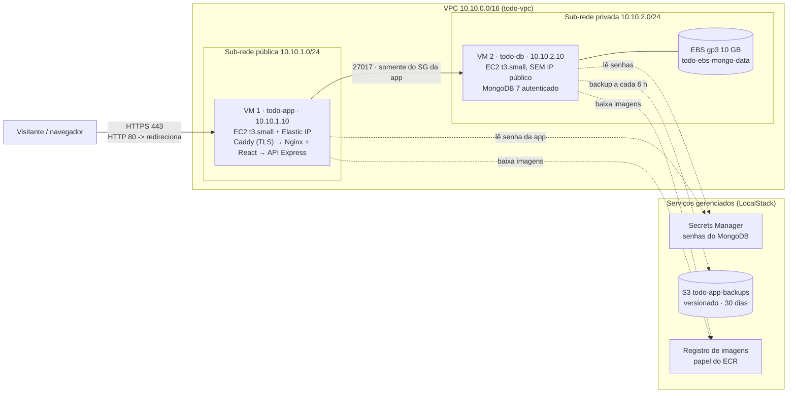
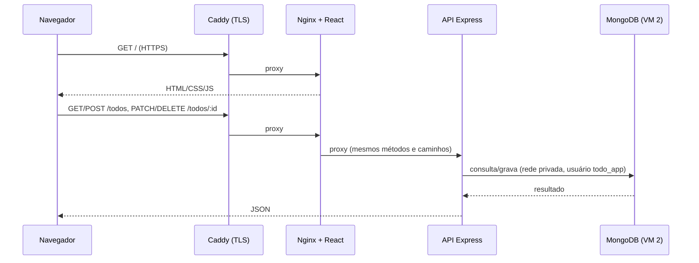

# Arquitetura · ToDo App na "nuvem" LocalStack

> **Ambiente alternativo.** A entrega principal roda na Google Cloud: [arquitetura](../arquitetura.md), [manual](../manual-alunos.md), [relatório](../relatorio-validacao.md). Este documento descreve a versão local, sem custo, mantida como plano B.

Documento de arquitetura da implantação do ToDo App para a Feira de Profissões, conforme o [escopo](../escopo.md).
Estão aqui as decisões, os diagramas, as premissas, as limitações e a estimativa de custos.

## 1. Decisão de provedor: LocalStack (AWS emulada)

A equipe optou por **não usar uma conta de nuvem real**. A infraestrutura é descrita para a **AWS** e executada no **LocalStack**, um emulador local dos serviços da AWS.

| Critério | Consequência |
| --- | --- |
| Custo | Zero. Nada é cobrado, não existe risco de esquecer recurso ligado e não depende de cartão ou créditos. |
| Reprodutibilidade | Qualquer máquina com Docker recria o ambiente inteiro com `./scripts/pipeline.sh ciclo-completo`. O GitHub Actions faz isso a cada push. |
| Fidelidade | O Terraform usa o **provider `aws` oficial**, com VPC, sub-redes, Security Groups, EC2, EBS, Elastic IP, NAT, S3, IAM e Secrets Manager. Ir para a AWS real exige também substituir as VMs Docker, o TLS e o estado (seção 8). |
| Acesso público | **Não há URL pública na internet.** Essa é a principal limitação frente ao REQ-05 (seção 7). |

**Versão fixa: LocalStack Community 4.14.** As versões 2026.x passaram a exigir token de conta mesmo no plano gratuito, e a 4.14 é a última Community que roda sem cadastro.

## 2. Visão geral

### Como as "VMs" existem de verdade

A EC2 do LocalStack Community é **apenas simulada**: a API responde, mas nenhuma máquina sobe. Para a aplicação de fato rodar, o mesmo Terraform usa um segundo provider, o `kreuzwerker/docker`, e materializa cada instância como uma **VM local**:

| Recurso declarado na "AWS" | Materialização local (mesmo Terraform) |
| --- | --- |
| `aws_instance.app` / `aws_instance.db` | Contêineres `todo-vm-app` / `todo-vm-db`, cada um com **seu próprio Docker Engine** (Docker-in-Docker), hostname e cron. São o equivalente às VMs. |
| IPs privados 10.10.1.10 / 10.10.2.10 | Os mesmos IPs na rede Docker `todo-vpc` (10.10.0.0/16). |
| Elastic IP + regras 80/443 do `todo-app-sg` | Portas 80/443 publicadas **somente** na VM da aplicação. |
| `todo-db-sg`: 27017 apenas do SG da aplicação | O MongoDB escuta só no IP privado, e uma regra `iptables` na VM do banco descarta 27017 de qualquer origem que não seja 10.10.1.10. A origem permitida vem do Terraform. |
| Volume EBS de dados | Volume Docker `todo-ebs-mongo-data` montado em `/mnt/mongo-data`, separado do "disco de sistema" da VM. |
| Perfil IAM da instância e metadados | Variáveis `TODO_*` e `AWS_*` injetadas pelo Terraform na VM. |

Os valores ficam ligados entre si: o IP privado, o ID da instância e a origem permitida no firewall saem dos recursos `aws_*`. A VM é recriada quando a instância é recriada; o volume de dados, não.

## 3. Fluxo da aplicação

Adaptações feitas no código (escopo, seção 5):

| Antes | Depois |
| --- | --- |
| Frontend chamava `http://localhost:5000` | Caminhos relativos (`/todos`). O Nginx encaminha `/todos`, `/todos/:id` e `/health` para a API no mesmo endereço. |
| URL do Mongo com `root:rootpassword` fixa no código | `MONGO_URI_FILE` (segredo montado) ou `MONGO_URI`. Usuário próprio `todo_app`, só com `readWrite` em `todo-app`. |
| Compose publicava 27017 e 5000 | Só a porta 80 é publicada (local). Na nuvem, só 80/443 da VM da app. |
| Sem volume nomeado | Volume nomeado (local) e EBS (nuvem). |
| `cors()` aberto | CORS desligado por padrão (mesma origem); só é ativado se `CORS_ORIGIN` for definido. |
| API falhava uma vez se o banco não estivesse pronto | Nova tentativa com espera crescente, `GET /health` com ping no banco, respostas 503 enquanto o banco não volta e `depends_on: service_healthy`. |
| `mongo:latest` | `mongo:7.0` fixo (uma troca de versão principal poderia tornar os dados incompatíveis). |
| Teste do frontend quebrado (`learn react`) | Testes reais do fluxo, com a API simulada. |

## 4. Segurança e acessos (REQ-02, REQ-03)

- **Exposição:** só a VM da aplicação recebe tráfego de fora (80/443). A VM do banco não tem IP público, não publica portas e aceita 27017 apenas da aplicação. Isso é verificado pelo `verificar-isolamento`, inclusive com uma tentativa de **outro host da VPC** (10.10.1.99), que é bloqueada.
- **Administração sem SSH:** nenhum Security Group libera a porta 22. Na AWS, a administração seria pelo **SSM Session Manager**, e a política IAM das instâncias já inclui as permissões. No ambiente local, o equivalente é `docker exec` nas VMs, que só quem opera o Docker da máquina consegue fazer.
- **Privilégio mínimo (IAM):** a VM da aplicação só lê o segredo `todo/mongo-app-password`. A VM do banco lê os dois segredos e só grava e lê `s3://todo-app-backups/mongo/*`.
- **Segredos fora do código, do estado e dos logs:**
  1. O `pipeline.sh` gera as senhas (`openssl rand -hex 24`) e as guarda em `.local/segredos/`, que não é versionado.
  2. As senhas vão para o **Secrets Manager** por stdin, sem aparecer em argumentos de comando.
  3. O Terraform apenas *referencia* os segredos (`data`), então as senhas **não entram no estado**.
  4. Nas VMs, `ops.sh` grava os segredos em arquivos `0400` e o Compose os monta como `secrets`. O MongoDB lê `*_FILE`, os scripts leem o arquivo **dentro** do contêiner e o `mongodump` usa `--config`. A senha nunca vai para a linha de comando.
  5. O teste de aceite procura as senhas reais no código versionado, nos logs das duas VMs e nas evidências.
- **HTTPS:** o Caddy termina o TLS, redireciona HTTP para HTTPS (308) e envia HSTS. Sem domínio público, o certificado é da **CA interna do Caddy**. Para o navegador confiar, `./scripts/pipeline.sh exportar-ca` exporta a CA. Os testes validam a cadeia com `--cacert`, sem `--insecure`.

## 5. Persistência, backup e restauração (REQ-04)

| Camada | Como |
| --- | --- |
| Dados | MongoDB em `/mnt/mongo-data/db`, no volume EBS. Sobrevive à recriação do contêiner, à atualização da imagem e ao reinício da VM. Isso é testado no aceite (ACE-05). O `init-mongo.js` só roda com a pasta vazia, então atualizações não reinserem dados. |
| Backup automático | Cron na VM do banco a cada 6 h: `mongodump --gzip` para S3 (`todo-app-backups/mongo/`), com as 5 cópias mais recentes também no EBS. |
| Backups preventivos | Antes de todo deploy do banco, de limpar a lista, de restaurar e de desativar. |
| Retenção | 30 dias no S3 (lifecycle), versionamento, criptografia AES256 e bloqueio de acesso público. |
| Cópia fora da "nuvem" | `pipeline.sh backup` também exporta para `.local/backups/`. É **necessária** no LocalStack Community, que perde o S3 quando reinicia. |
| Restauração de teste | `restaurar-teste` sobe um MongoDB temporário **sem rede** (`--network none`), restaura, mostra contagem e amostra e remove tudo. A produção não é tocada (ACE-07). |
| Restauração real | `restaurar <backup>` faz um backup de segurança, depois `mongorestore --drop` só do banco `todo-app`. Exige digitar `RESTAURAR`. |

## 6. Automação (pipelines) e infraestrutura como código

**Ferramentas:** Terraform 1.9.8 (em contêiner), com os providers `hashicorp/aws ~> 5.80` (LocalStack) e `kreuzwerker/docker ~> 3.0` (VMs). Bash e Docker Compose cuidam da configuração e da operação das VMs. O GitHub Actions executa os pipelines. Os alunos só precisam de **Docker e Git Bash**.

| Operação do escopo | Rotina (`./scripts/pipeline.sh …`) |
| --- | --- |
| Validar e planejar | `validar` (testes, shellcheck, `terraform fmt/validate`, compose) · `planejar` (`terraform plan`) |
| Provisionar e configurar | `subir-localstack` · `provisionar` (`plan` + `apply` do plano exibido) |
| Implantar e atualizar | `implantar` (versão = SHA do commit; health check e teste HTTPS) · `implantar <versão>` = rollback sem rebuild · `versoes` |
| Manter e diagnosticar | `status` · `logs-app` · `logs-banco` · `reiniciar-app` · `reiniciar-banco` |
| Proteger e recuperar | `backup` · `backups` · `restaurar-teste` · `restaurar` |
| Desativar | `desativar` (backup final e exportação, depois `terraform destroy`; lista o que permanece) |
| Evidências | `verificar-isolamento` · `aceite` |

| Workflow | Quando | O que faz |
| --- | --- | --- |
| `.github/workflows/ci.yml` | PR e push | `validar` + integração com Compose (fluxo completo, persistência, portas fechadas) |
| `.github/workflows/localstack.yml` | push na `main` e manual | Runner limpo: LocalStack, `plan`, `apply`, `implantar`, `aceite`, checagem de plano idempotente, ensaio de rollback, `desativar`. Anexa o relatório de aceite. |

**Versões identificáveis:** as imagens `frontend` e `backend` recebem como tag o SHA curto do commit (com o sufixo `-localMMDDHHMM` se houver alteração não commitada). A imagem do banco recebe a tag `db-<hash do conteúdo de banco-de-dados/>`, então atualizar a aplicação **não reinicia o MongoDB**. O histórico fica em `.local/releases.log` e em `/opt/todo/releases.log` de cada VM.

**Estado do Terraform:** backend `local` em `infra/terraform/estado/` (fora do Git). Ele não fica no LocalStack porque o Community perde tudo ao reiniciar e o estado precisa sobreviver a isso. Antes de cada `apply` e `destroy`, uma cópia com data vai para `.local/estado-backups/` (as 20 mais recentes). Para recuperar, basta copiar a versão desejada de volta para `estado/terraform.tfstate`.

**Se o LocalStack reiniciar:** os recursos "AWS" somem, mas o Docker e os dados continuam. Basta rodar `provisionar` e depois `implantar`, e o banco volta com os dados intactos. Esse cenário foi testado: o volume de dados propositalmente **não** depende do ID do EBS, para não ser recriado.

## 7. Limitações e premissas

| Limitação | Impacto e mitigação |
| --- | --- |
| **Sem URL pública na internet** (REQ-05 / ACE-04 "em outro dispositivo") | O HTTPS funciona em `https://localhost`. Para outro dispositivo **na mesma rede (Wi-Fi da feira)**: provisionar com `SITE_ADDRESS=<ip-da-máquina>.sslip.io` e instalar a CA no dispositivo, ou aceitar o aviso do navegador. Uma URL pública de verdade exigiria AWS real (seção 8). |
| Certificado da CA interna | Navegadores mostram aviso até a CA ser instalada (`exportar-ca`). |
| LocalStack Community não persiste | O pipeline recria segredos e recursos, e os backups têm cópia em `.local/backups/`. |
| EC2 simulada | As VMs são contêineres Docker-in-Docker com `privileged`. Isso é fiel em rede, disco e isolamento de processos, mas não em hipervisor, CPU ou memória reservadas. |
| ECR é recurso Pro | Substituído por `registry:2` (HTTP, só na máquina e na rede interna). |
| Security Group emulado | A regra fica na API (`describe-security-group-rules`) e é **aplicada** via `iptables` na VM do banco. O LocalStack não filtra tráfego sozinho. |
| Dois ajustes de compatibilidade no Terraform | `ignore_changes` em `vpc_security_group_ids` e em `referenced_security_group_id`, porque o LocalStack devolve esses campos em outro formato. Os dois estão comentados no código. |
| Lista compartilhada | Como no escopo: todos os visitantes veem e alteram a mesma lista. A rotina `limpar-lista` prepara uma lista nova antes de cada apresentação. |

**Premissas** (o escopo diz que ainda não foram informadas): a feira tem algumas dezenas de visitantes simultâneos no máximo; a preparação dura 7 dias e o evento, 1 dia; a máquina dos alunos tem Docker Desktop com pelo menos 8 GB de RAM.

## 8. Custos (ACE-09)

### Custo real desta solução

| Item | Custo |
| --- | --- |
| LocalStack Community, Terraform, Docker, registro local | R$ 0 (software livre ou gratuito) |
| GitHub Actions (`ci.yml` + `localstack.yml`) | R$ 0 em repositório público. Em privado, consome a cota gratuita de minutos, cerca de 15 a 20 min por execução do `localstack.yml`. |
| Energia e máquina dos alunos | Fora do escopo |
| **Total mensal e do período da feira** | **R$ 0**, sem nada gerando cobrança após o evento |

### Referência: o mesmo Terraform na AWS real

Estimativa **aproximada**, para comparação, com preços públicos on-demand da AWS em **us-east-1 (USD)** conhecidos até 2025. **Os preços não foram consultados na data deste documento: confira na [AWS Pricing Calculator](https://calculator.aws/) antes de usar.** Créditos e free tier não estão incluídos.

| Recurso | Preço unitário | Mês (730 h) | Período da feira (8 dias = 192 h) |
| --- | --- | --- | --- |
| 2 × EC2 t3.small | US$ 0,0208/h cada | US$ 30,37 | US$ 7,99 |
| NAT Gateway | US$ 0,045/h + US$ 0,045/GB | US$ 32,85 | US$ 8,64 |
| 2 IPv4 públicos (Elastic IP da app + NAT) | US$ 0,005/h cada | US$ 7,30 | US$ 1,92 |
| EBS gp3 (2 × 8 GB sistema + 10 GB dados) | US$ 0,08/GB-mês | US$ 2,08 | US$ 0,55 |
| Secrets Manager (2 segredos) | US$ 0,40/segredo-mês | US$ 0,80 | US$ 0,21 |
| S3 + ECR (menos de 1 GB) | US$ 0,023 e US$ 0,10/GB-mês | ≈ US$ 0,15 | ≈ US$ 0,04 |
| Tráfego de saída | primeiros 100 GB/mês gratuitos | ≈ US$ 0 | ≈ US$ 0 |
| **Total** | | **≈ US$ 73,6/mês** | **≈ US$ 19,4** |

O NAT Gateway representa cerca de 45% do custo. Trocá-lo por *VPC endpoints*, ou dar à VM do banco acesso de saída só durante a manutenção, reduziria o total para perto de US$ 40/mês. Depois do evento continuariam cobrando apenas o S3 com os backups e os segredos, se fossem mantidos (centavos por mês).

**Para migrar para a AWS real:** remover os `endpoints` e as credenciais `test` do `provider "aws"`; remover os recursos `docker_*`, que dariam lugar a `user_data` nas instâncias instalando Docker e copiando `deploy/`; criar o ECR; trocar `tls internal` por um domínio real no Caddyfile; e usar um backend S3 + DynamoDB para o estado.
