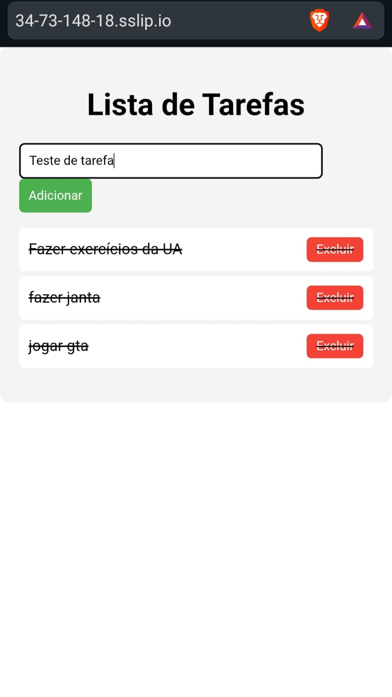
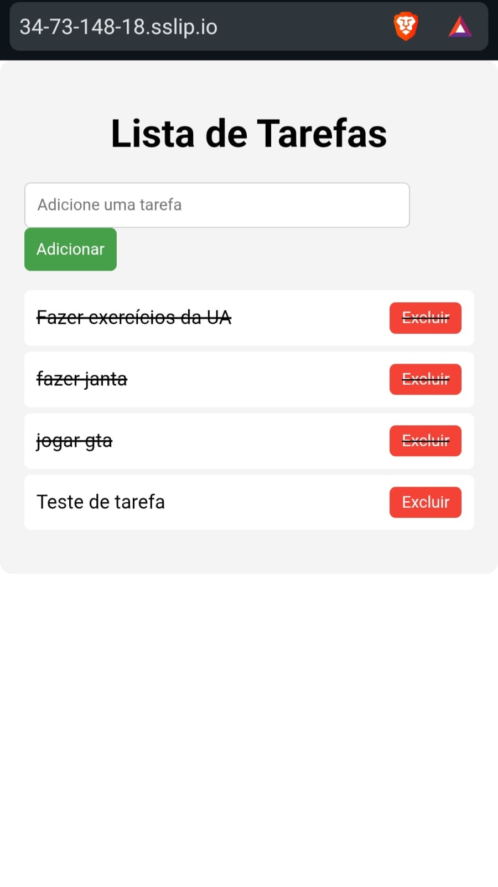

# Validação da demanda

Relação entre os requisitos do [documento de demanda](../../docs/escopo.md) e a infraestrutura entregue.

| Necessidade da demanda | Infraestrutura entregue | Onde está no código | Evidência |
| --- | --- | --- | --- |
| Pelo menos duas VMs, MongoDB em VM exclusiva | `todo-app` (aplicação) e `todo-db` (só MongoDB) | [`infra/gcp/compute.tf`](../../infra/gcp/compute.tf) | Inventário do Terraform; aceite ACE-02 |
| Banco fora da internet, porta 27017 só para a API | VM do banco em sub-rede privada, sem IP público; firewall `todo-mongo` só da conta de serviço da aplicação | [`infra/gcp/network.tf`](../../infra/gcp/network.tf) | Teste de isolamento, abaixo |
| Administração restrita | SSH só pela faixa do IAP (35.235.240.0/20); porta 22 fechada na internet | [`infra/gcp/network.tf`](../../infra/gcp/network.tf), [`inventario.yml`](../../infra/ansible/inventario.yml) | Teste de isolamento, abaixo |
| Segredos fora do código e dos logs | Senhas no Secret Manager; GitHub autenticado por OIDC, sem chave | [`infra/gcp/iam.tf`](../../infra/gcp/iam.tf), [`infra/gcp-ci/`](../../infra/gcp-ci/) | Tarefas Ansible com `no_log` |
| Persistência e backup | Disco de dados de 10 GB separado; backup a cada 6 h no Cloud Storage | [`infra/gcp/storage.tf`](../../infra/gcp/storage.tf), [`roles/banco`](../../infra/ansible/roles/banco/) | Backups de 25/11 às 00, 06, 12 e 18 h; restauração testada |
| URL HTTPS, frontend e API no mesmo endereço | Caddy com certificado Let's Encrypt | [`deploy/app/Caddyfile`](../../deploy/app/Caddyfile) | Prints do celular, abaixo |
| Reinício e verificação de saúde | `restart` nos contêineres; Ansible confere `/health` (API + banco) a cada implantação | [`roles/aplicacao`](../../infra/ansible/roles/aplicacao/tasks/main.yml) | Log da etapa 3 da pipeline |

## Aplicação pela URL pública (celular)

https://34-73-148-18.sslip.io: cadastrar, listar e concluir uma tarefa.

| 1. Digitando uma nova tarefa | 2. Tarefa cadastrada e listada | 3. Tarefa concluída |
| --- | --- | --- |
|  |  |  |

## Isolamento do banco (`scripts/verificar-isolamento.sh`)

```text
  [OK] VM do banco sem IP público (privado: 10.10.2.10)
  [OK] 27017 fechada na internet (34.73.148.18)
  [OK] 22 fechada na internet (34.73.148.18)
  [OK] banco inacessível desta máquina (10.10.2.10)
  [OK] 443 responde (o teste de porta funciona)
  [OK] VM da aplicação alcança o banco pela rede privada
  [OK] MongoDB escuta apenas em 10.10.2.10:27017
  [OK] API conectada ao banco
```

## Critérios de aceite

Aceite completo pelo GitHub Actions: [45704640419](https://github.com/SoaresPedroBit/todo-app/actions/runs/45704640419). Detalhes de ACE-01 a ACE-10 em [`docs/relatorio-validacao.md`](../../docs/relatorio-validacao.md).
